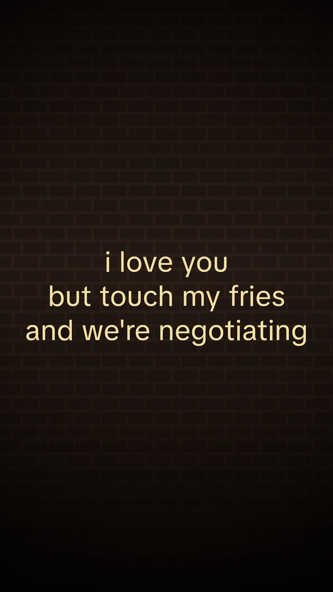
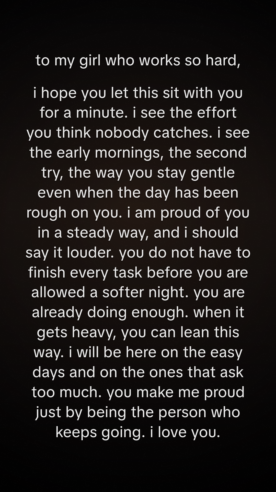
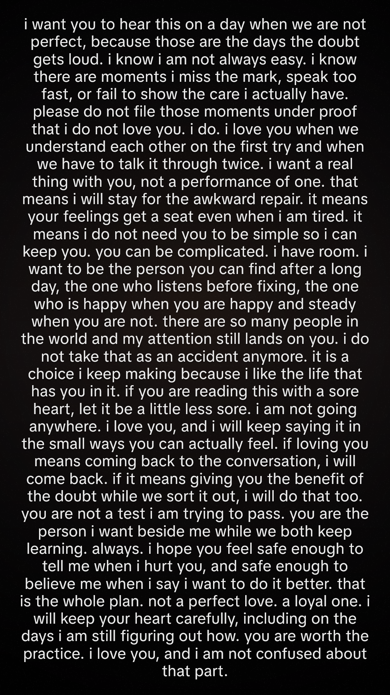

# Video template 7: Dark Love Letter

Spill It video tab, template id 7. A 1080×1920 clip: a dim, almost-still background with a heavy darken, vignette, and film grain, plus one block of centred lowercase text. The words are on screen from the first frame to the last. Nothing scrolls.

How long the clip holds depends on the text:

- A short quote holds for 5 seconds, in large pale yellow type, so a 10-word line does not flash.
- A short letter (about 100–150 words) holds for 8 seconds. The type is larger than a long letter, with wide margins, so it does not look cramped or lost in the frame.
- A medium letter (about 150–230 words) holds for 10 seconds, between those two sizes.
- A long letter keeps the original 5 second hold. It fills the frame in small white type at about 92% opacity, with a soft shadow, about 5% side margins, and a line height of 1.15.

The stills above are rendered from `paintVideoTemplate7Overlay`. The quote is a new playful one-liner. The short letter opens with a headline line and a blank line. The long letter is one of the new longer notes. An older long-letter reference is still in `letter.png`, and an older quote reference is in `quote.png`.

## How to use

1. Open the app, choose **Spill It**, then the **Video** tab.
2. Pick **Dark Love Letter**.
3. **Length** chooses the pool. It defaults to **Random**, which is an even mix of quote, short, medium, and long.
   - **Quote** draws a short line-broken note.
   - **Short**, **Medium**, and **Long** draw a letter in that band.
4. **Text** chooses the copy:
   - **Random letter** draws a letter. If Length is Short, Medium, or Long, it stays in that band. **New letter** picks another.
   - **Random short quote** draws from the short quotes. **New quote** picks another.
   - **Custom text** keeps whatever you type. A short custom note is drawn like a quote. A long one is drawn like a letter. Editing a random pick switches the control to custom.
5. **Shuffle background** loads another portrait Pexels clip (dark bedroom, dim room, night window, bokeh, stairs, and similar).
6. **Download** records the preview through the same MediaRecorder to MP4 path as the other Pexels templates (`exportCouplesNatureVideo`). The recording is capped at the hold for the current text.

The bank is `app/lib/video-template-7-love-letter.json`: 52 letters (30 original long letters, plus short, medium, and a few longer ones) and 33 quotes. The card cover is `public/video-templates/template-7-cover.jpg`.
