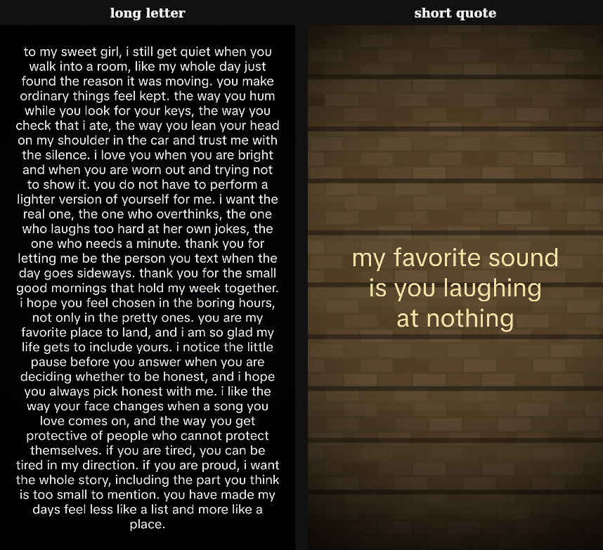

# Video template 7: Dark Love Letter

Spill It video tab, template id 7. A 5 second 1080×1920 clip: a dim, almost-still background with a heavy darken, vignette, and film grain, plus one static block of centred lowercase text. The words are on screen from the first frame to the last.

Long letters are regular-weight white type at about 92% opacity, with a soft shadow, about 5% side margins, and a line height of 1.15. A letter of roughly 220 to 300 words fills the frame at about 33 to 35 lines. Short quotes are larger, pale yellow, and sit in the middle with wide empty margins.

The stills above are rendered from `paintVideoTemplate7Overlay` (long letter on a dark room, short quote on a stair wall). Type size, line spacing, darken, vignette, and grain were adjusted against the attached reference stills over three passes.

## How to use

1. Open the app, choose **Spill It**, then the **Video** tab.
2. Pick **Dark Love Letter**.
3. **Text** chooses the copy:
   - **Random letter** draws from the 30 letters in `app/lib/video-template-7-love-letter.json`. **New letter** picks another.
   - **Random short quote** draws from the 15 short quotes. **New quote** picks another.
   - **Custom text** keeps whatever you type. A short custom note is drawn like a quote. A long one is drawn like a letter. Editing a random pick switches the control to custom.
4. **Shuffle background** loads another portrait Pexels clip (dark bedroom, dim room, night window, bokeh, stairs, and similar).
5. **Download** records the preview through the same MediaRecorder to MP4 path as the other Pexels templates (`exportCouplesNatureVideo`), capped at 5 seconds.

The card cover is `public/video-templates/template-7-cover.jpg`.
