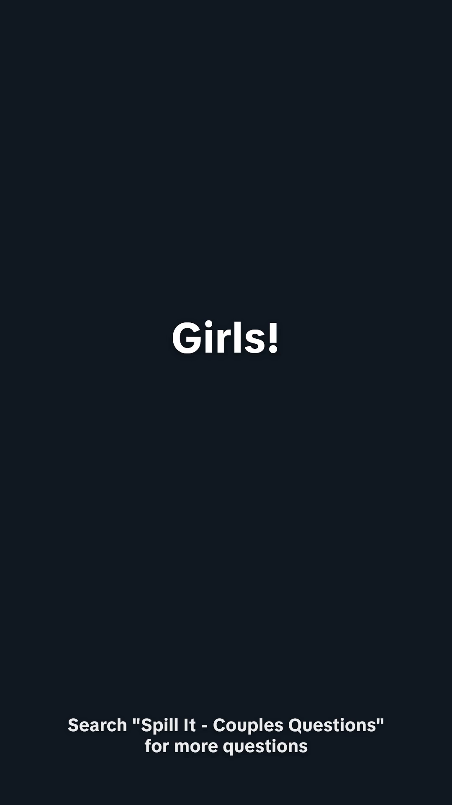

# Daily quiz videos and the phone library

Two Spill It video-tab templates render one spoken MP4 each morning. The files are the website library at `/library`. Google Drive is optional and is not required to download them.

## Templates

| Video tab | Id | Daily workflow | What it says |
| --- | --- | --- | --- |
| How well do you know your girlfriend | 8 | Daily know your girlfriend, 08:00 UTC | Opens with "Girls!", the title, then "Send this to him. If he gets them all right, unlimited kisses." Questions are about her. |
| Quiz your boyfriend | 9 | Daily quiz your boyfriend, 08:20 UTC | The existing quiz-your-partner style, boyfriend side, using the funny-question bank. One template, not a separate girlfriend job. |

Both are a single portrait video with a voiceover. They are not slideshows. A second run on the same UTC day does nothing unless `DAILY_QUIZ_FORCE=1`.

Preview either template from Spill It → Video. Play voice uses ElevenLabs. The file Isaac downloads from his phone is the one the daily job saved.

## GitHub Actions secrets

Required on the repository (same names as the existing daily video job, plus storage):

- `PIXELS_API_KEY` — Pexels background clips
- `BLOB_READ_WRITE_TOKEN` — Vercel Blob store for the MP4s
- `MONGODB_URI` — metadata in the `bleamies.dailyVideos` collection
- `ELEVENLABS_API_KEY` — natural voice. If this is unset, the job uses `OPENAI_API_KEY` with `tts-1-hd` instead.

Optional:

- `OPENAI_API_KEY` — fallback voice when ElevenLabs is not set
- `SPILL_QUIZ_TTS_MODEL` — defaults to `eleven_multilingual_v2`
- `SPILL_QUIZ_VOICE_KNOW_HER` — defaults to Rachel (`EXAVITQu4vr4xnSDxMaL`)
- `SPILL_QUIZ_VOICE_QUIZ_BOYFRIEND` — defaults to Charlotte (`XB0fDUnXU5powFXDhCwa`). If that voice is not on the account, the job retries with Rachel.
- `DAILY_QUIZ_DRIVE_FOLDER_ID` plus the existing Google OAuth secrets — extra copy in Drive. The library is not cleared when this upload fails, and the job does not empty the folder.

The Vercel routes `/api/cron/daily-video-template-8` and `/api/cron/daily-video-template-9` stay at 501. ffmpeg does not run there.

## Phone check

1. Open `https://imagetotiktok.vercel.app/library` and enter the site password.
2. Each saved clip shows a player, Download, and Delete.
3. Download on iPhone opens the share sheet when the browser allows sharing a file. Save the video, post it, then come back and delete that card.
4. Leave the others. They stay until you delete them.
5. To make today's pair before the schedule, run the two workflows with **Run workflow**. A successful day is skipped if you run it twice.
